# 🚀 Awesome Enterprise Document Collaboration Suite ✨

<p align="center">
  
</p>

<p align="center">
  <a href="https://github.com/ishandutta2007/Awesome-Awesome-Awesome"></a><a href="https://discord.gg/jc4xtF58Ve"></a>
  <a href="https://github.com/ishandutta2007/Awesome-Enterprise-Document-Collaboration-Suite/stargazers"></a>
  <a href="https://github.com/ishandutta2007/Awesome-Enterprise-Document-Collaboration-Suite/network/members"></a>
  <a href="https://github.com/ishandutta2007/Awesome-Enterprise-Document-Collaboration-Suite/blob/main/LICENSE"></a>
  <a href="https://github.com/ishandutta2007"></a>
</p>

---

# 📝 Top Enterprise Document Collaboration Suite 🌟

> **The definitive curated directory of SaaS commercial platforms & open-source software for real-time document collaboration, team spreadsheets, collaborative presentations, connected wikis, and sovereign self-hosted office suites.** ⚡

*Last updated: November 2026* 📅

Welcome to the **Awesome Enterprise Document Collaboration Suite** list! 🎉 Whether your organization is evaluating cloud office suites, migrating away from vendor lock-in, adopting real-time document co-authoring engines, or deploying on-premises sovereign workspace infrastructure compliant with GDPR and HIPAA, this resource provides an up-to-date, transparent comparison of both leading commercial SaaS products and top open-source repositories. 💼

---

## 📑 Table of Contents 🧭

- [📊 Sector Overview & Market Dynamics](#-sector-overview--market-dynamics)
- [☁️ SaaS & Commercial Document Collaboration Platforms](#️-saas--commercial-document-collaboration-platforms)
- [💻 Open-Source Document Collaboration Repositories](#-open-source-document-collaboration-repositories)
- [🎯 Key Architectural Paradigms: CRDT vs OT](#-key-architectural-paradigms-crdt-vs-ot)
- [📈 Star History](#-star-history)
- [🛠️ How to Contribute](#️-how-to-contribute)
- [⚠️ Disclaimer](#️-disclaimer)
- [💖 Support & Community](#-support--community)

---

## 📊 Sector Overview & Market Dynamics 📈

The global Cloud Office, Enterprise Content Collaboration & Connected Workspace software market is estimated at **$68B–$78B+ in 2026**, growing at a sustained CAGR of ~13%–16% driven by AI copilot integrations, remote/hybrid enterprise collaboration, and digital sovereignty mandates. 🌐

The industry demonstrates a bifurcated competitive landscape:
- **Core Cloud Office Suites (Word, Excel, PPT, Cloud Storage)** 🏢: **Highly concentrated** around an entrenched duopoly—Microsoft 365 and Google Workspace capture upwards of 85%+ enterprise market share (winner-take-most dynamics).
- **Connected Knowledge Bases, Modular Docs & Team Wikis** 🧠: **Moderately fragmented**, featuring rapid growth and intense product differentiation among modern challengers like Notion, Coda, Craft, Slite, and ClickUp Docs.
- **Data-Sovereign & Self-Hosted Infrastructure** 🛡️: Rapidly expanding segment driven by open-source platforms (Nextcloud Hub, OnlyOffice, Collabora, Outline, AppFlowy, Univer) catering to European GDPR requirements, public sector mandates, air-gapped security, and zero per-seat licensing fees.

---

## ☁️ SaaS & Commercial Document Collaboration Platforms 🌐

The table below catalogs leading enterprise SaaS collaboration suites, sorted in **descending order by company scale (market capitalization / enterprise valuation / annual recurring revenue)**. 📊

| Platform | Category & Core Focus | Company Scale (Valuation / Revenue) | Starting Paid Tier (Pricing) | Free Forever Plan & Free Trial Limits |
| :--- | :--- | :--- | :--- | :--- |
| **[Microsoft 365](https://www.microsoft.com/microsoft-365)** | Enterprise cloud office suite (Word, Excel, PowerPoint, Loop, SharePoint, Teams & Copilot) | **Part of Microsoft Corp.** (~$3.1T Market Cap / ~$245B+ Annual Revenue) | **$6.00 / user / month** billed annually (Microsoft 365 Business Basic) | **Forever Free Web Plan** (Free browser-based Word/Excel/PowerPoint with **5 GB OneDrive storage** per personal account; 30-day Business trial with full features for up to 25 users) |
| **[Google Workspace](https://workspace.google.com)** | Cloud-native collaborative office suite (Docs, Sheets, Slides, Drive, Meet & Gemini) | **Part of Alphabet Inc.** (~$2.1T Market Cap / ~$350B+ Annual Revenue) | **$6.00 / user / month** billed annually (Business Starter; 30 GB storage/user) | **Forever Free Personal Tier** (Unlimited collaborative Docs, Sheets, Slides with **15 GB pooled Google Drive storage**; 14-day Enterprise Workspace free trial) |
| **[Quip](https://quip.com)** | Salesforce-native collaborative docs, live CRM spreadsheets, and embedded deal rooms | **Part of Salesforce Inc.** (~$300B Market Cap / ~$38B+ Annual Revenue) | **$10.00 / user / month** billed annually (Quip Starter; Quip Plus at **$25/user/mo**) | **14-Day Full-Feature Free Trial** (Complete access for team document/spreadsheet collaboration; no perpetual free tier after 14 days) |
| **[Notion](https://www.notion.so)** | Connected workspace uniting collaborative docs, relational databases, enterprise wikis & AI | **~$10.0B Valuation** (~$400M+ ARR; private unicorn backed by Sequoia/Coatue) | **$10.00 / user / month** billed annually ($12/user/month billed monthly for Plus) | **Forever Free Plan** (Unlimited pages and blocks for individual users, **5 MB maximum file upload limit**, 7-day page history, up to 10 guest collaborators; 14-day Team trial) |
| **[Dropbox Paper](https://www.dropbox.com/paper)** | Real-time lightweight collaborative notes, task tracking, and rich media workspace | **Part of Dropbox Inc.** (~$8.5B Market Cap / ~$2.5B+ Annual Revenue) | **$9.99 / month** (Dropbox Plus individual) or **$15.00 / user / month** billed annually (Standard Team) | **Forever Free Basic Plan** (Full unlimited access to Dropbox Paper documents with **2 GB Dropbox storage limit** across maximum 3 linked devices; 30-day Business trial) |
| **[Box Notes](https://www.box.com/notes)** | Enterprise-grade secure real-time collaborative notes embedded in Box Content Cloud | **Part of Box Inc.** (~$4.8B Market Cap / ~$1.1B+ Annual Revenue) | **$15.00 / user / month** billed annually (Box Business plan, 3-user minimum) | **Forever Free Individual Plan** (Up to **10 GB cloud storage limit**, 250 MB single-file upload cap, unlimited Box Notes creation; 14-day Business trial) |
| **[Coda](https://coda.io)** | All-in-one collaborative doc & canvas blending docs, spreadsheets, buttons & automations | **~$1.4B Valuation** (Merged under Grammarly at ~$13B combined valuation) | **$10.00 / Doc Maker / month** billed annually ($12/mo monthly for Pro; Editors & Viewers are free) | **Forever Free Plan** (Unlimited doc viewers/editors, maximum **50 objects per doc limit** on unshared/shared docs, and 1,000 table rows limit per document) |
| **[Zoho Workplace](https://www.zoho.com/workplace/)** | Comprehensive enterprise office suite (Zoho Writer, Sheet, Show, WorkDrive & Cliq) | **~$1.4B+ Annual Revenue** (Bootstrapped enterprise SaaS leader; >100M global users) | **$3.00 / user / month** billed annually (Workplace Standard; includes 30 GB Mail + 10 GB WorkDrive) | **Forever Free Plan** (Strictly free for up to **5 team users**, 5 GB storage per user, web-based Writer/Sheet/Show; 15-day unrestricted trial of paid plans) |
| **[Craft for Teams](https://www.craft.do)** | Native-performance modular structured docs, team knowledge sharing, and visual wiki | **~$100M+ Valuation** (~$12.2M Series B funding; Apple Design Award winner) | **$8.00 / month** billed annually (Plus plan) or **$15.00 / month** for Team tier | **Forever Free Starter Plan** (Up to **1,000 blocks total limit**, 1 GB cloud storage limit, unlimited device sync, 30-day version history; 14-day Team trial) |
| **[Slite](https://slite.com)** | AI-first collaborative team knowledge base with verified doc answers and change audits | **~$30M–$50M Est. Valuation** (~$15.4M total VC funding from Index Ventures & YC) | **$8.00 / member / month** billed annually ($10/member/month billed monthly for Standard) | **14-Day Full-Access Free Trial** (Includes complete AI knowledge verification, integrations with Slack/Linear/GitHub; no perpetual free tier once trial expires) |

---

## 💻 Open-Source Document Collaboration Repositories 🔓

The table below lists top open-source document collaboration projects, real-time rich text/spreadsheet engines, and self-hosted team wikis. 🛠️

Each repository includes its official GitHub star count badge (using `style=social` and `color=white`), linking directly to the repository's stargazers page, and is sorted in **descending order by GitHub star count**. 🌟

| Repository & Project | GitHub Stars (Live Badge) | License | Primary Architecture / Tech Stack | Overview & Enterprise Capabilities |
| :--- | :--- | :--- | :--- | :--- |
| **[AppFlowy](https://github.com/AppFlowy-IO/AppFlowy)** | [](https://github.com/AppFlowy-IO/AppFlowy/stargazers) | AGPL-3.0 | Flutter / Rust / SQLite | Open-source Notion alternative prioritizing local-first data ownership, offline support, cross-platform desktop/mobile sync, and enterprise plugin extensibility. |
| **[AFFiNE](https://github.com/toeverything/AFFiNE)** | [](https://github.com/toeverything/AFFiNE/stargazers) | MIT | TypeScript / Rust / CRDT (Yjs) | Next-generation all-in-one collaborative workspace that merges docs, visual whiteboards, and database tables into a single unified canvas with local-first sync. |
| **[Penpot](https://github.com/penpot/penpot)** | [](https://github.com/penpot/penpot/stargazers) | MPL-2.0 | Clojure / ClojureScript / SVG | Web-based open-source collaborative design, UI prototyping, and multi-user whiteboard platform using native web standards (SVG/CSS) for design and product teams. |
| **[Joplin](https://github.com/laurent22/joplin)** | [](https://github.com/laurent22/joplin/stargazers) | AGPL-3.0 | TypeScript / React Native / Node.js | Secure, open-source note-taking and document collaboration application with end-to-end encryption (E2EE) and self-hosted Joplin Server synchronization. |
| **[SiYuan](https://github.com/siyuan-note/siyuan)** | [](https://github.com/siyuan-note/siyuan/stargazers) | AGPL-3.0 | TypeScript / Go / Block-level CRDT | Privacy-first personal and team knowledge management system with block-level bidirectional linking, full SQL query engine, and self-hosted cloud sync. |
| **[Logseq](https://github.com/logseq/logseq)** | [](https://github.com/logseq/logseq/stargazers) | AGPL-3.0 | ClojureScript / Rust / CRDT | Privacy-first, local-first outliner and knowledge base with graph visualization, bi-directional linking, task management, and encrypted sync protocols. |
| **[Outline](https://github.com/outline/outline)** | [](https://github.com/outline/outline/stargazers) | BSL 1.1 / Apache-2.0 | TypeScript / React / Node.js / PostgreSQL | Fast, collaborative team knowledge base and wiki featuring Markdown editing, Slack/Google SSO authentication, real-time multiplayer co-authoring, and enterprise search. |
| **[Tiptap](https://github.com/ueberdosis/tiptap)** | [](https://github.com/ueberdosis/tiptap/stargazers) | MIT | TypeScript / ProseMirror / Yjs | Headless, extensible rich text editor framework powering collaborative document editing in hundreds of enterprise SaaS web applications. |
| **[Nextcloud Server (Hub)](https://github.com/nextcloud/server)** | [](https://github.com/nextcloud/server/stargazers) | AGPL-3.0 | PHP / JavaScript / MariaDB / Redis | Sovereign self-hosted productivity cloud suite providing Nextcloud Office (integrated Collabora Online / OnlyOffice), Nextcloud Files, Talk, Groupware, and enterprise governance. |
| **[Univer](https://github.com/dream-num/univer)** | [](https://github.com/dream-num/univer/stargazers) | Apache-2.0 | TypeScript / Canvas / WebAssembly | Enterprise-grade full-stack document, spreadsheet, and slide collaboration SDK with real-time multi-user editing, high-performance canvas rendering, and formula engine. |
| **[Wiki.js](https://github.com/requarks/wiki)** | [](https://github.com/requarks/wiki/stargazers) | AGPL-3.0 | Node.js / Vue.js / PostgreSQL | Modern and extensible open-source wiki software for teams, featuring multi-engine editors (Markdown, Visual, Code), Git-backed storage, and SSO integrations. |
| **[Yjs](https://github.com/yjs/yjs)** | [](https://github.com/yjs/yjs/stargazers) | MIT | JavaScript / Rust (yrust) / CRDT | High-performance Conflict-free Replicated Data Type (CRDT) engine powering real-time peer-to-peer and client-server collaborative document applications globally. |
| **[Docmost](https://github.com/docmost/docmost)** | [](https://github.com/docmost/docmost/stargazers) | AGPL-3.0 | TypeScript / NestJS / React / Tiptap | Modern open-source collaborative wiki and document platform with real-time multiplayer editing, nested spaces, permissions, and self-hosted Docker deployment. |
| **[BookStack](https://github.com/BookStackApp/BookStack)** | [](https://github.com/BookStackApp/BookStack/stargazers) | MIT | PHP / Laravel / MySQL | Simple, self-hosted documentation and knowledge management system organized hierarchically by Books, Chapters, and Pages with granular role-based access control. |
| **[Etherpad Lite](https://github.com/ether/etherpad-lite)** | [](https://github.com/ether/etherpad-lite/stargazers) | Apache-2.0 | Node.js / Operational Transformation (OT) | Highly customizable, real-time collaborative text editor with version history playback (Time Slider), rich plugin ecosystem, and embeddable iframe API. |
| **[Documenso](https://github.com/documenso/documenso)** | [](https://github.com/documenso/documenso/stargazers) | AGPL-3.0 | TypeScript / Next.js / Prisma | The open-source digital document signing and contract workflow platform designed to provide an unbundled, self-hostable alternative to DocuSign. |
| **[CryptPad](https://github.com/cryptpad/cryptpad)** | [](https://github.com/cryptpad/cryptpad/stargazers) | AGPL-3.0 | JavaScript / ChainPad CRDT / Sodium | End-to-end encrypted (zero-knowledge) collaborative office suite including rich text docs, spreadsheets, code pads, kanban boards, and presentations. |
| **[HedgeDoc](https://github.com/hedgedoc/hedgedoc)** | [](https://github.com/hedgedoc/hedgedoc/stargazers) | AGPL-3.0 | Node.js / React / OT / Markdown | Real-time collaborative Markdown editor with live side-by-side preview, YAML frontmatter support, math rendering (KaTeX), and presentation mode. |
| **[ONLYOFFICE Document Server](https://github.com/ONLYOFFICE/DocumentServer)** | [](https://github.com/ONLYOFFICE/DocumentServer/stargazers) | AGPL-3.0 | C++ / JavaScript / HTML5 Canvas | High-fidelity enterprise office suite with native OOXML compatibility (DOCX, XLSX, PPTX), collaborative co-editing modes, and seamless Nextcloud/Alfresco integration. |
| **[Collabora Online](https://github.com/CollaboraOnline/online)** | [](https://github.com/CollaboraOnline/online/stargazers) | MPL-2.0 | C++ / LibreKit / JavaScript | Enterprise-ready, cloud-based LibreOffice-powered editing engine for text documents, spreadsheets, and presentations with complete data sovereignty and WOPI support. |
| **[XWiki Platform](https://github.com/xwiki/xwiki-platform)** | [](https://github.com/xwiki/xwiki-platform/stargazers) | LGPL-2.1 | Java / Groovy / Velocity / Solr | Comprehensive enterprise wiki application platform with advanced document management, fine-grained ACLs, extension manager, and Confluence migration tools. |

---

## 🎯 Key Architectural Paradigms: CRDT vs OT 🏗️

Enterprise document collaboration platforms rely on two primary concurrency control models:

```
+-----------------------------------------------------------------------------------+
|                        Concurrency Control Architectures                          |
+-----------------------------------------------------------------------------------+
| 1. Operational Transformation (OT)                                                |
|    - Used by: Google Docs, Etherpad, Microsoft 365                                |
|    - Requires a centralized authority / server to linearize and transform edits. |
|    - Strengths: Proven stability, fine-grained control over document state.       |
|    - Limitations: High server dependency, complex offline conflict resolution.    |
+-----------------------------------------------------------------------------------+
| 2. Conflict-free Replicated Data Types (CRDTs)                                   |
|    - Used by: Yjs, AFFiNE, AppFlowy, Univer, Notion (hybrid)                      |
|    - Allows edits to merge deterministically without central server coordination. |
|    - Strengths: Native offline-first / local-first, peer-to-peer sync, resilience.|
|    - Limitations: Metadata overhead, tombstone garbage collection challenges.    |
+-----------------------------------------------------------------------------------+
```

---

## 📈 Star History

[](https://www.star-history.com/#ishandutta2007/Awesome-Enterprise-Document-Collaboration-Suite&type=date&legend=top-left)

---

## 🛠️ How to Contribute 🤝

Contributions are welcome! Please follow these guidelines:

1. **Check Existing Entries** 🔍: Search the tables to ensure the platform or open-source repository isn't already included.
2. **Open-Source Criteria** 📋: Must be actively maintained on GitHub with clear documentation, open license, and relevant document/knowledge collaboration focus.
3. **Format Standards** 📐: Ensure all columns (Valuation/Revenue scale, starting tier pricing, explicit free tier limits, star badges linking to stargazers) are filled out accurately.
4. **Submit a Pull Request** 🚀: Submit your PR with a clear description and commit message following standard conventions.

---

## ⚠️ Disclaimer 📌

Product pricing, free tier limits, features, and company valuations change over time. The pricing information is sourced from publicly available provider pricing pages and SEC filings as of late 2026. Please verify directly with each provider for real-time commercial enterprise agreements.

---

## 💖 Support & Community 🙏

Thank you so much for exploring this curated repository! If this resource has helped you or your engineering and IT teams discover, evaluate, or deploy enterprise document collaboration solutions, please consider supporting the project:

- ⭐ **Star this repository** on GitHub to help others discover it.
- 🍴 **Fork and contribute** new tools, benchmarks, and updates.
- 📢 **Share with colleagues, tech communities, and on social media.**
- ☕ **Buy a coffee & sponsor ongoing maintenance:** Support the author on the [GitHub Sponsors Dashboard](https://github.com/sponsors/ishandutta2007)! Every bit of support is deeply appreciated! ❤️
